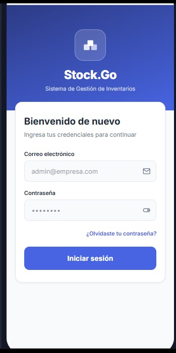
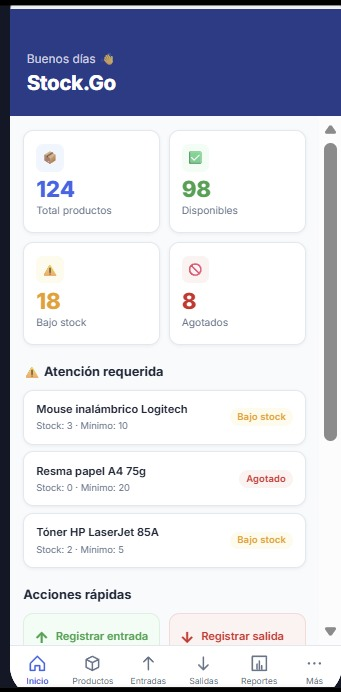
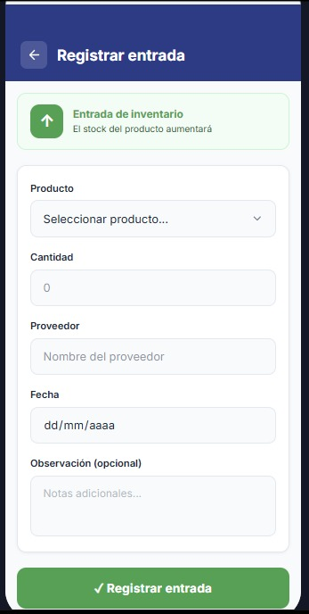
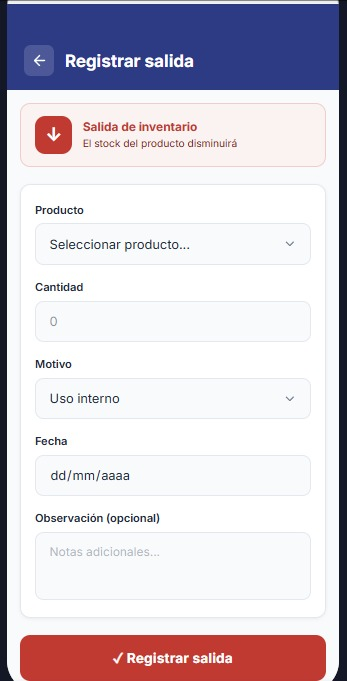
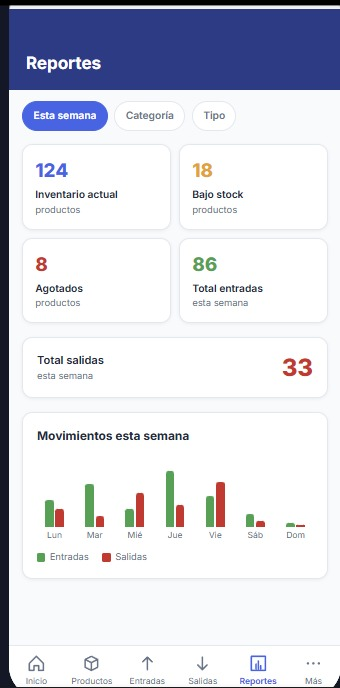
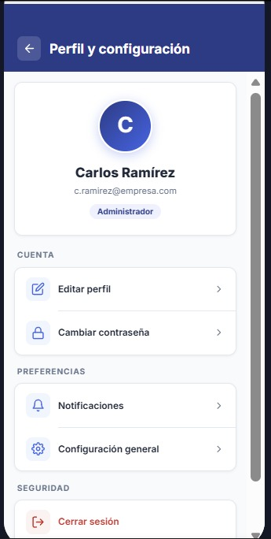
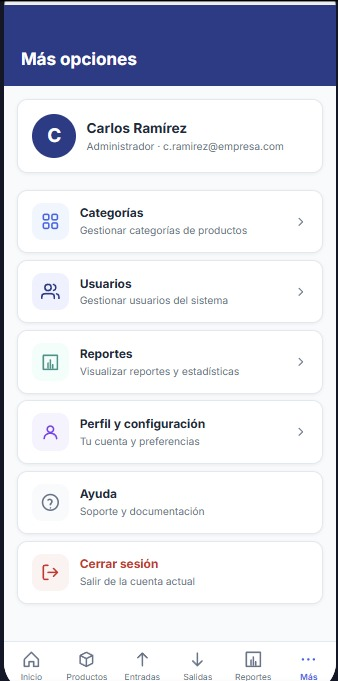
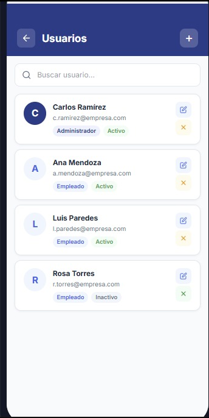

# Diseño de interfaz de usuario - Stock.Go

La aplicación contará con las siguientes pantallas y sus respectivos diseños visuales:

## Pantalla 1: Inicio de sesión
Permite al usuario ingresar al sistema mediante su correo electrónico y contraseña. También cuenta con una opción para recuperar la contraseña.

## Pantalla 2: Dashboard
Presenta un resumen general del inventario, mostrando el total de productos, productos disponibles, productos con bajo stock y productos agotados. También incluye alertas, acciones rápidas y movimientos recientes.

## Pantalla 3: Registrar entrada
Permite registrar el ingreso de productos al inventario mediante información como producto, cantidad, proveedor, fecha y observaciones.

## Pantalla 4: Registrar salida
Permite registrar la salida de productos del inventario indicando el producto, cantidad, motivo, fecha y observaciones.

## Pantalla 5: Reportes
Visualización de estadísticas y movimientos de stock del sistema.

## Pantalla 6: Perfil y configuración
Permite consultar y administrar la información del usuario, editar el perfil, cambiar la contraseña, configurar preferencias y cerrar sesión.

## Pantalla 7: Más opciones
Presenta un menú de acceso a diferentes funcionalidades del sistema, como categorías, usuarios, reportes, perfil y configuración, ayuda y cierre de sesión.

## Pantalla 8: Usuarios
Módulo de administración y control de usuarios con acceso a la plataforma.

